# 10xEngineers EDA

**The design-verification suite for VS Code and Cursor.** Open one RTL file and get self-checking SystemVerilog, UVM and cocotb testbenches, regressions on Icarus, Verilator, Questa or VCS, a live dashboard, an Excel test plan, waveforms with protocol decoders, formal proof and sign-off. No simulator install and no license are needed for the open-source flow.

[](https://marketplace.visualstudio.com/items?itemName=WaseemAbbas.10xengineer-eda)
[](https://marketplace.visualstudio.com/items?itemName=WaseemAbbas.10xengineer-eda)
[](LICENSE.txt)

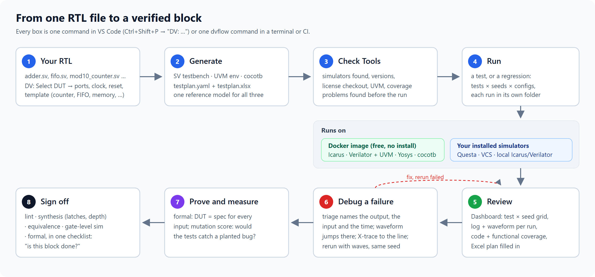

## Highlights

| | |
|---|---|
| **Testbenches are generated for you** | A self-checking SV testbench, a full UVM environment and a cocotb testbench, all generated from your ports and sharing one test plan and reference model |
| **It recognises your design** | It names the design type (adder, mux, FIFO, ALU, APB slave…) from your ports and code and explains why, at 96% accuracy on an outside benchmark |
| **106-design library** | Gates through AXI, each with a spec and RTL proven against it. Start any project from one |
| **No license, no installs** | Icarus, Verilator with UVM, Yosys, SymbiYosys and cocotb download as one Docker image on the first run. Questa and VCS are used when you have them |
| **Evidence, not opinions** | A dashboard with pass rate, code and functional coverage and coverage holes, plus a test plan in YAML and Excel where every requirement is linked to the runs that prove it |
| **Debug in minutes** | Failure triage, waveforms written only for failing tests, 11 protocol decoders, X-trace back to the RTL line, and FSM states |
| **Sign-off and quality** | Lint, synthesis, equivalence checking, gate-level simulation, formal proof and mutation testing in one checklist |

## Get started in 4 steps

| Step | Do this |
|---|---|
| **1. Install Docker** | Docker Desktop (Windows, macOS) or Docker Engine (Linux or WSL). Start it once. Skip this step if your simulators are already installed |
| **2. Install the extension** | Extensions view (`Ctrl+Shift+X`) → **10xEngineers EDA** → Install |
| **3. Open your design** | Open the `.sv` file → `Ctrl+Shift+P` → **DV: Select DUT** → **DV: Generate Testbench → All** |
| **4. Run** | **DV: Run Regression** → **DV: Open Dashboard**. The first run downloads the tools once (~1.2 GB, with progress in the Output panel) |

New to it? **10xEngineers EDA: Create Demo Project** opens a guided tour, and **Help → Welcome → 10xEngineers EDA** walks through each step. You can also start from a ready design with **DV: New Design from Library**.

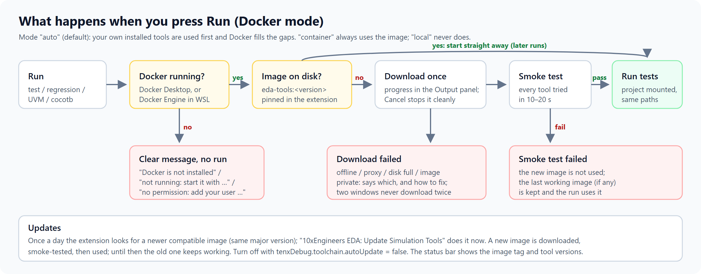

## Walkthrough: one design, seven steps

A mod-10 counter on QuestaSim, from RTL to a verified block. Each picture is a frame from the demo video, with the step on the left and the relevant part highlighted.

| | |
|---|---|
| 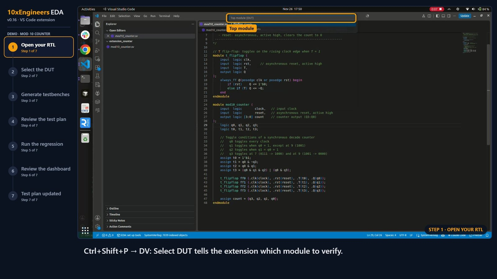 **1 · Select the DUT.** Ports, clock and reset are read from the RTL | 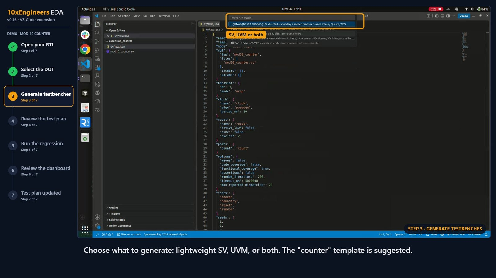 **2 · Generate** the SV, UVM and cocotb testbenches and the test plan |
| 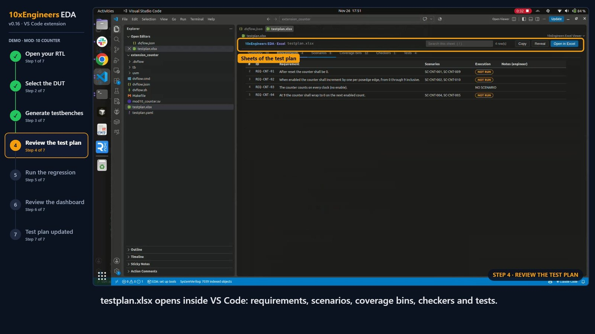 **3 · Review the test plan:** requirements, scenarios and bins, in Excel inside VS Code | 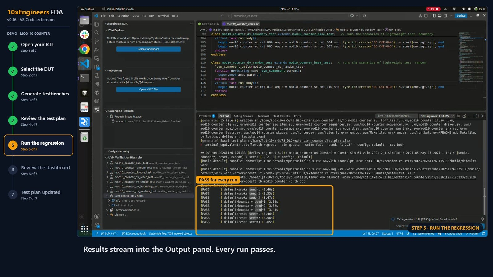 **4 · Run the regression.** Every test × seed runs in its own folder |
| 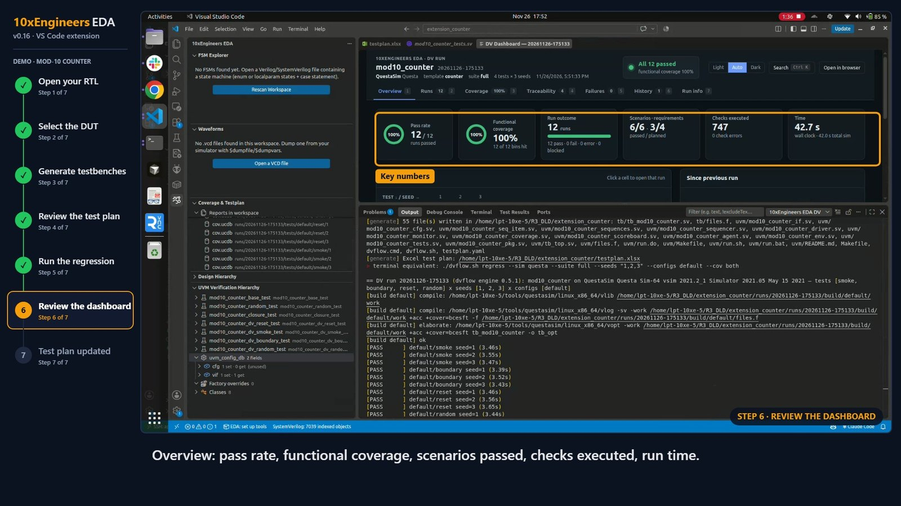 **5 · Review the dashboard:** pass rate, coverage, checks and run time | 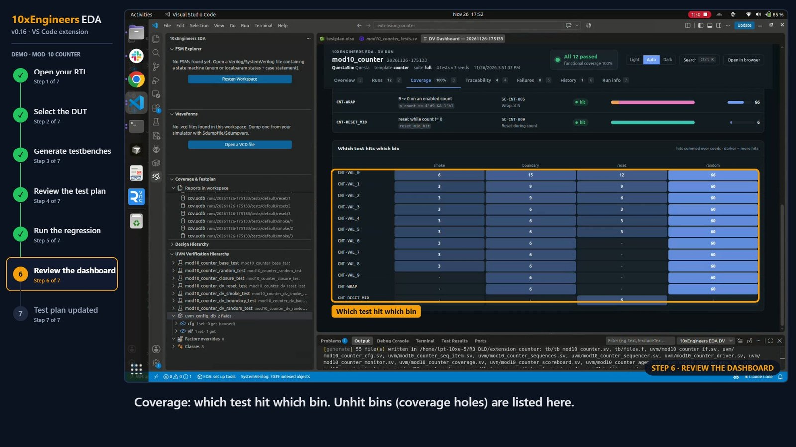 **6 · Close coverage:** which test hit which bin, and the holes |
| 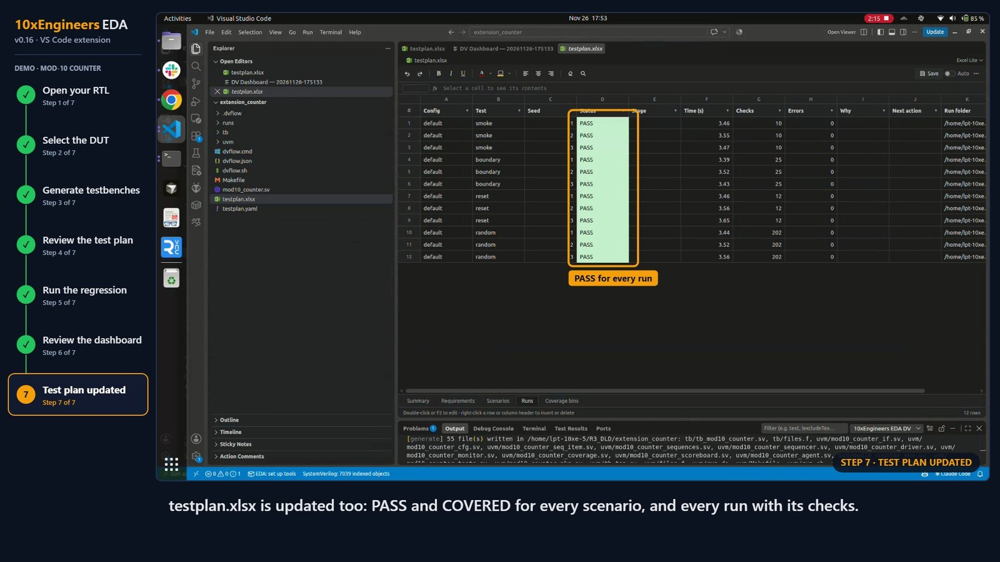 **7 · Test plan updated:** PASS / FAIL and COVERED for every scenario | |

## Features

### Testbench generation and identification
**DV: Select DUT** scores your ports, widths, module name and code, suggests a template, and shows the reasons. Protocol interfaces (APB, AHB, AXI4-Lite, AXI-Stream, Wishbone, SPI, I²C, UART) are recognised too, several at once when a block has more than one. **DV: Generate Testbench** then writes the SV testbench, the UVM environment, the cocotb testbench and the test plan.

These templates check a design automatically:

- Combinational: adder, subtractor, adder-subtractor, multiplier, comparator, mux, demux, encoder, priority encoder, decoder, binary ↔ Gray converter, parity, logic gate.
- Sequential: D flip-flop, latch, shift register, counter, up/down counter, pipeline, FIFO (including first-word-fall-through), memory.

For any other design, **DV: Write Expected Behaviour** gives you one field per output:

- Write each output as an expression of the inputs, for example `op == 0 ? a + b : a - b`.
- Every field is checked as you type: syntax, names (*did you mean*), widths, and an example value.
- An optional AI draft can fill the fields from your spec text. It is off unless you turn it on, and nothing is sent without your confirmation.

### Design library: 106 designs with specs
Logic gates, arithmetic, mux/demux, encoders and decoders, codes (parity, CRC, Gray, Hamming, BCD), ALUs, flip-flops and shifters, counters (LFSR, program counter), memories and register files, FIFOs, state machines, and protocol blocks (APB, AHB-Lite, AXI4-Lite, AXI-Stream, Wishbone, SPI, I²C, UART).

Every design has a `SPEC.md` and RTL proven against it by its own self-check. **DV: New Design from Library** gives you the RTL, the spec and ready-to-run testbenches. See [examples/library](examples/library/README.md) and the [sweep report](examples/library/SWEEP-REPORT.md).

### Regressions and the dashboard
- Run Icarus, Verilator, Questa or VCS (and GHDL for VHDL), with seeds, suites and configuration sweeps.
- Every run gets its own folder with its log, `results.json` and `junit.xml`.
- By default a waveform is written only for a failing test, which is re-run with the same seed.
- The dashboard has a test × seed grid, a run panel with log and waveform, coverage, traceability, failures, history and compare, all searchable with `Ctrl+K`.

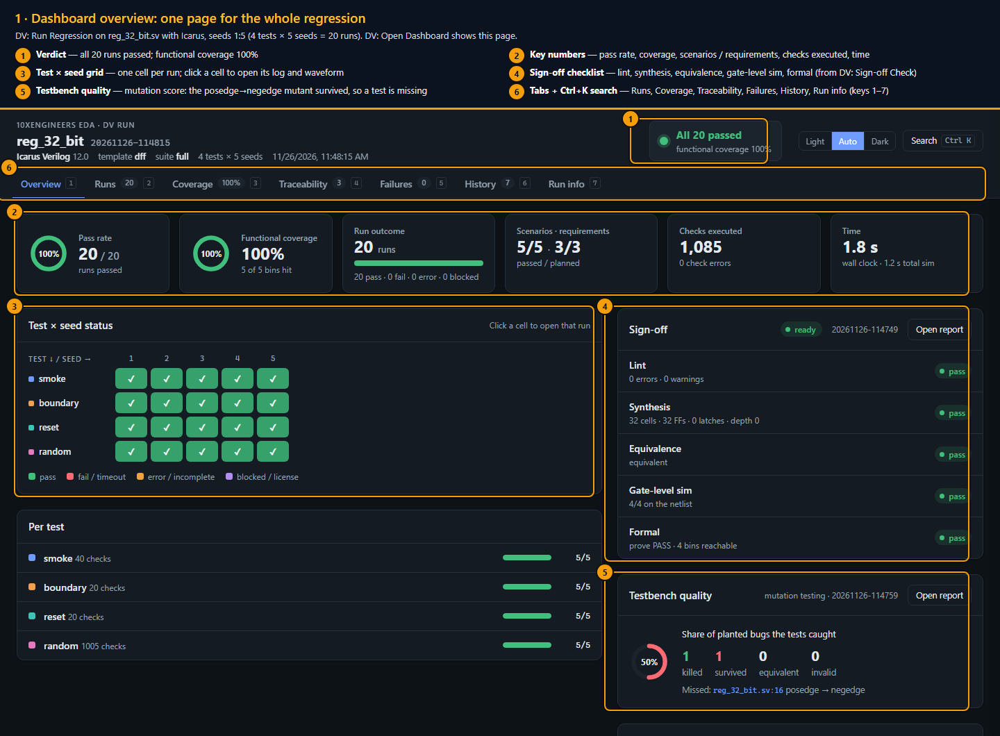

### Coverage and the test plan
- Functional coverage bins, and code coverage (line, branch, expression, toggle) on Verilator or Questa, with the uncovered lines listed.
- `testplan/testplan.yaml` and `testplan/testplan.xlsx` are updated after every run with PASS / FAIL, bins hit and the reason for every non-pass. The Excel file opens inside VS Code.

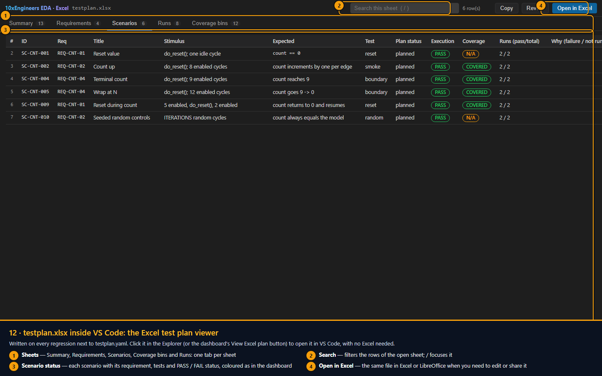

### Debug
- **Waveform viewer:** opens `.vcd` (plus `.fst` and `.lxt` through GTKWave's converters) with markers, search, diff, switching activity, `.gtkw` import, log correlation, and the value of each signal shown inline in your RTL.
- **Protocol decoders (11):** APB, AHB-Lite, AXI4-Lite, AXI-Stream, Wishbone, SPI, SPI-Flash, I²C, UART, RISC-V trace and valid/ready, each with a transaction table.
- **X-trace** walks an X back to the RTL line that creates it.
- **Failure triage** names the output, expected vs actual, the input and the time, and opens the waveform there.

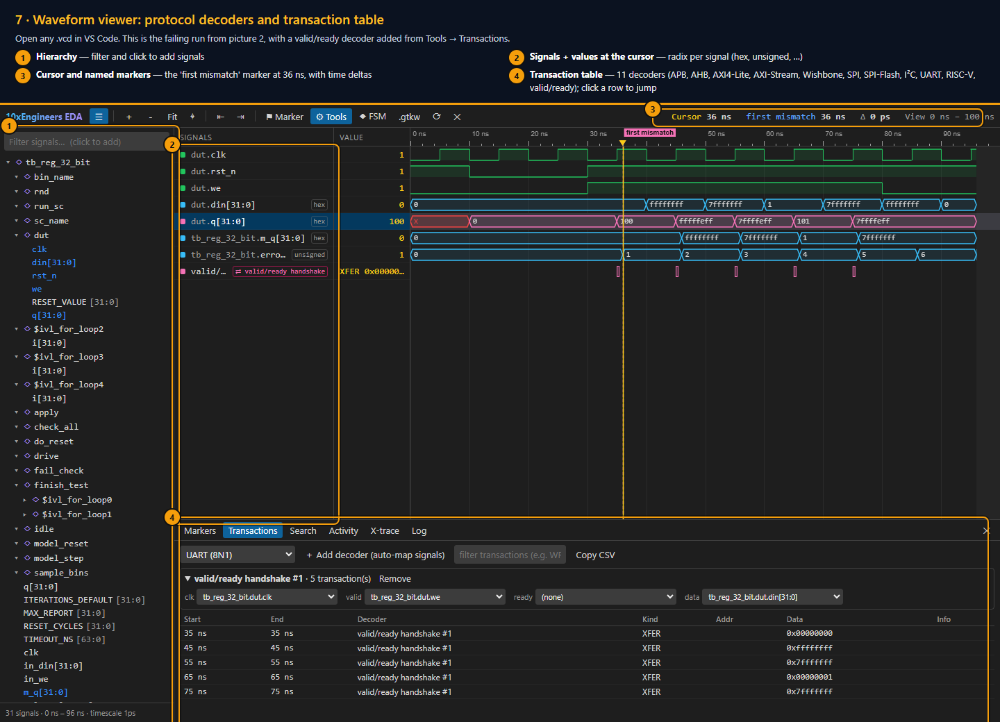

### Formal, sign-off and testbench quality
**DV: Sign-off Check** runs lint, Yosys synthesis (latches, logic depth), equivalence checking, gate-level simulation of your testbench on the netlist, and a SymbiYosys proof that the DUT matches the spec for every input. **DV: Mutation Test** plants bugs and reports how many your tests catch.

### UVM tools, language support and more
- **UVM:** the architecture diagram, class graph, `config_db` cross-reference, UVM lint, and generators for sequence items and sequences.
- **Language support:** SystemVerilog highlighting, completion, go to definition, references, hover and inlay hints.
- **Lint and structure:** lint with waivers and quick fixes, Yosys schematics with *what drives this?*, and FSM diagrams.
- **Other:** WaveDrom diagrams turned into SVA, RISC-V assembly, and an MCP server so AI agents can run and read your regressions.

## Project structure

```text
my_block/
├── dvflow.json          DUT, clock/reset, expected behaviour
├── design/              your RTL
├── testplan/            testplan.yaml + testplan.xlsx
├── tb/                  self-checking SV testbench
├── uvm/                 tb/ agent/ sequences/ env/ tests/ scripts/
├── cocotb/              Python testbench
└── runs/<run-id>/       logs, waves, results.json, junit.xml, dashboard
```

## Supported tools

| Tool | How it is used |
|---|---|
| Icarus Verilog 12, Verilator 5.054 (+ UVM), Yosys, SymbiYosys, GHDL, cocotb 2.1 | From the Docker image `ghcr.io/engineerwaseem121-dot/eda-tools`, or your own installation |
| QuestaSim / ModelSim, Synopsys VCS | From your installation and license (**DV: Configure Simulators**, **DV: Check Tools**) |
| Platforms | Windows (Docker Desktop or Docker Engine in WSL) and Linux; VS Code and Cursor |

Every step is also a terminal command, for make and CI: `dvflow init`, `regress`, `uvm`, `cocotb`, `signoff`, `mutate`, `library`, `new`, `check-tools`, `toolchain`.

## Main commands

All commands are in the Command Palette (`Ctrl+Shift+P`) under **10xEngineers EDA**.

| Area | Commands |
|---|---|
| Start | Create Demo Project, DV: New Design from Library, DV: Select DUT, DV: Write Expected Behaviour, DV: Generate Testbench |
| Run | DV: Run Test, DV: Run Regression, DV: Rerun Failed Test, DV: Retry Last Run, DV: Check Tools |
| Review | DV: Open Dashboard, DV: View Test Plan (Excel), Open Waveform, Show Coverage Dashboard |
| Prove | DV: Sign-off Check, DV: Formal Proof, DV: Gate-Level Simulation, DV: Mutation Test |
| Tools | Set Up Open-Source Toolchain, Update Simulation Tools, Open Terminal in Container |

## Troubleshooting

| Message | Fix |
|---|---|
| *No container engine found* | Install Docker and start it |
| *Docker is installed in WSL but not running* | `wsl -u root systemctl start docker`, or start Docker Desktop |
| *could not reach ghcr.io* | You are offline or behind a proxy: connect, or configure Docker's proxy |
| *No DV project in this folder* | Use the buttons in the message: **Select DUT in this file**, **Create Demo Project** or **Open Folder** |
| *reference model is not written yet* | Run **DV: Write Expected Behaviour**, or pick the template that matches the design |
| A test fails | That is the testbench working: open the dashboard, where triage shows the output, expected vs actual and the time |

## Documentation

- [Reference](docs/REFERENCE.md): every feature in detail
- [Design library](examples/library/README.md): the conventions, and how to add a design
- [Docker toolchain](container/README.md): images, modes and offline use
- [Maintainers](docs/MAINTAINERS.md): releasing the extension and the tools image
- [Changelog](CHANGELOG.md)

Built by 10xEngineers. MIT license. Feedback and issues: [GitHub](https://github.com/engineerwaseem121-dot/10xengineers-eda/issues).
