# 10xEngineers EDA: reference

The full reference for every feature. Start with the [README](../README.md) for an overview.

## Why design-verification engineers switch

| You used to… | With 10xEngineers EDA |
|---|---|
| Write a testbench by hand before you can run anything | Pick your RTL file; get a **self-checking SV testbench, a full UVM environment and a cocotb testbench**, wired to your DUT's ports, in seconds |
| Need a Questa/VCS license to run UVM | Run **UVM on Verilator**, free |
| Install a simulator, a waveform viewer, a linter, a coverage tool… | Everything is in one extension, and the tools come in one Docker image |
| Hunt through waveforms for the first X | **X-trace** walks the X back through your RTL to the line where it starts |
| Read raw bus wiggles | **11 protocol decoders** (APB, AHB-Lite, AXI4-Lite, AXI-Stream, Wishbone, SPI, SPI-Flash, I²C, UART, RISC-V trace, valid/ready) give you a transaction table |
| Ask "is this block done?" and get opinions | **Sign-off Check**: lint, synthesis, equivalence, gate-level sim and formal in one checklist |
| Wonder whether your tests would catch a bug | **Mutation testing** plants bugs and scores your testbench |

## One extension instead of many

A Verilog/SystemVerilog/UVM engineer usually installs a separate extension for each job below. This one covers them all, and they work together: the dashboard opens the waveform at the failure time, the waveform cross-probes to the RTL, and coverage links back to the test plan.

| Job | Covered here | Typically done with |
|---|---|---|
| Verilog/SystemVerilog highlighting, snippets, formatter, completion, go to definition, references, hover, inlay hints | ✅ | Verilog-HDL/SystemVerilog, SystemVerilog, other HDL editor extensions |
| VCD waveform viewer: decoders, diff, X-trace, FSM states, switching activity, pattern search, `.gtkw` import, log correlation, inline RTL values | ✅ | WaveTrace, VaporView, Surfer, Impulse, WaveCrux, other VCD viewers |
| UVM generator (active/passive), validator, source list, sequence item and sequence generators | ✅ | UVM generator extensions |
| UVM class graph, architecture diagram, `config_db` cross-reference, UVM lint | ✅ | ElegantUVM and similar |
| Lint with waivers and quick fixes | ✅ | LintCrux, Verilator/Verible lint extensions |
| Schematic from Yosys, *what drives this / what does this drive* | ✅ | NetCrux, netlist viewers |
| Run Icarus / Verilator / Questa / VCS / cocotb, regressions, seed ranges | ✅ | SimCrux, simulator and cocotb runner extensions |
| Code and functional coverage (Questa UCDB, Verilator, LCOV), test plan, Excel export | ✅ | Coverage viewers |
| FSM diagrams, FSM coverage | ✅ | FSM viewer extensions |
| WaveDrom timing diagrams, with SVA generated from them | ✅ | WaveDrom preview extensions |
| RISC-V assembly and linker-script highlighting | ✅ | RISC-V assembly extensions |
| Formal, synthesis, gate-level simulation, equivalence checking, mutation testing | ✅ | Usually scripts outside the editor |

**Keep these alongside it** (we don't cover them yet):
- VHDL language support. We recognise `.vhd` files and show inline waveform values, but there is no VHDL highlighting or language server.
- Bluespec.
- Synopsys `.hvp` verification plans.
- Cadence Xcelium NCDB coverage.
- Opening `.fst` files directly. We convert them through GTKWave's `fst2vcd`.
- Full-elaboration IDEs such as Sigasi or DVT for very large designs.

> **Tip:** after installing, disable the extensions this one replaces. Two waveform viewers will both try to open `.vcd` files, two grammars will both colour `.sv` files, and lint findings can appear twice.

## What one RTL file turns into

Give it a Verilog/SystemVerilog design and it gives you:

- **Testbenches, generated:** a self-checking SystemVerilog testbench, a full **UVM** environment and a **cocotb** (Python) testbench, all sharing one test plan and one reference model
- **Regressions on any simulator:** Icarus, Verilator, Questa, VCS. Open-source tools run from a Docker image, so you install nothing else.
- **UVM with no license:** UVM testbenches run on Verilator
- **An interactive dashboard:** a test × seed grid, a run panel with log and **waveform**, coverage heatmap, traceability, failure triage, history and run comparison
- **Code and functional coverage**, on Verilator (free) or Questa, with the uncovered lines listed
- **Formal proof with no properties to write:** the DUT is proven equal to the spec for every input
- **Synthesis, gate-level simulation and equivalence checking:** latches, logic depth, netlist vs RTL
- **Testbench quality:** mutation testing shows whether your tests would actually catch bugs
- Plus waveforms with FSM decoding, UVM architecture diagrams, SystemVerilog language tools, RISC-V assembly, and an MCP server for AI agents

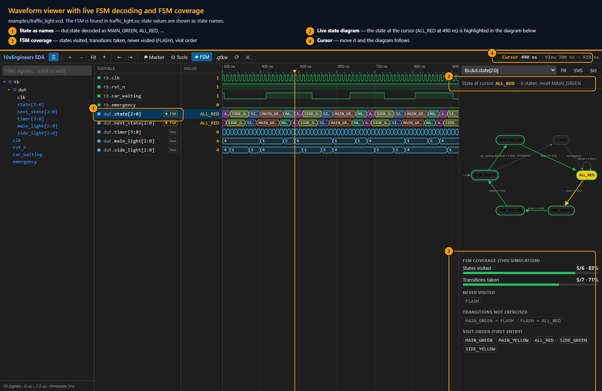

---


## See it working: one register, every step

Everything below was produced from **one file**: [`reg_32_bit.sv`](#the-design), a 32-bit register with write enable and asynchronous reset. Nothing else was written by hand. Each picture has numbered labels; the bar at its top explains each number.

| # | Step | Command (or `dvflow` on the command line) | Result |
|---|---|---|---|
| 1 | Generate everything | **DV: Select DUT**, then **DV: Generate Testbench → All** (`dvflow init --file reg_32_bit.sv --mode all`) | SV, UVM and cocotb testbenches, `testplan.yaml` **and** `testplan.xlsx`: 3 requirements, 5 scenarios, 5 coverage bins |
| 2 | Regression on Icarus | **DV: Run Regression**, seeds `1:5` | 20 / 20 passed, functional coverage 100% |
| 3 | Regression on Verilator, with code coverage | **DV: Run Regression → Verilator → coverage** | 12 / 12 passed; line, branch, expression and toggle coverage 100% |
| 4 | UVM on Verilator (no license) | **DV: Run Test → UVM testbench → Verilator** | 4 / 4 passed |
| 5 | cocotb | **DV: Run Test → cocotb testbench** | 4 / 4 passed |
| 6 | Sign-off | **DV: Sign-off Check** | lint, synthesis, equivalence, gate-level sim and formal all pass |
| 7 | Testbench quality | **DV: Mutation Test** | 50%: the `posedge → negedge` mutant survived, which shows a missing check |
| 8 | Plant a bug, then fix it | edit the RTL, **DV: Run Regression** twice | 0 / 8 with a precise triage, then 20 / 20 again |

### 1 · The dashboard after the regression
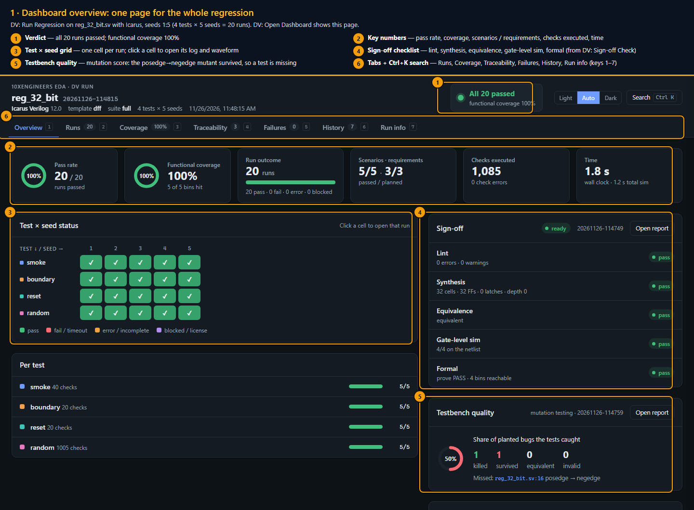

### 2 · A failing run: the log and the waveform side by side
A bug was planted on purpose (`q <= din ^ 32'h100`). Click the red cell to open the run.
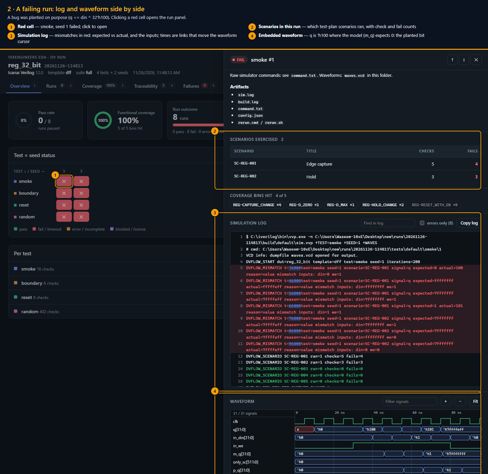

### 3 · Failure triage
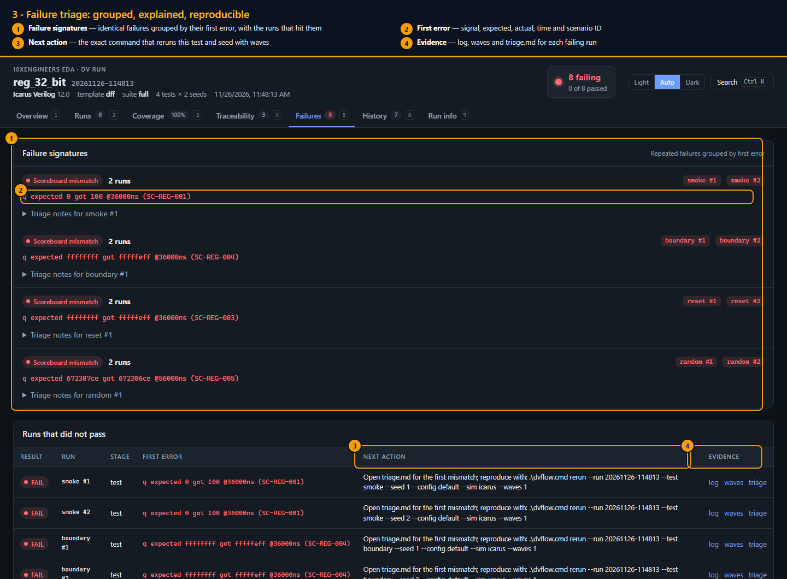

### 4 · Coverage: functional bins and code coverage
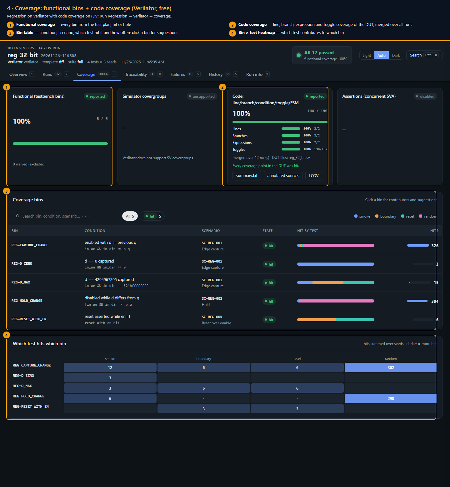

### 5 · Traceability: requirement → scenario → run
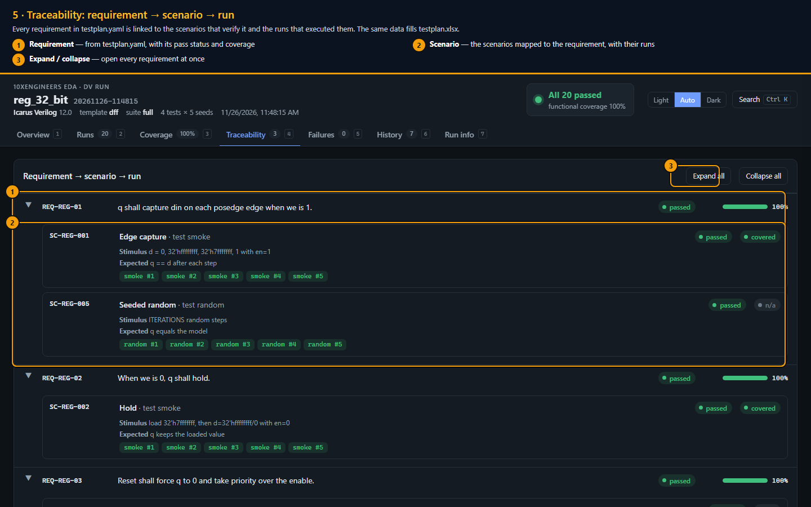

### 6 · History: the bug and the fix, across every run
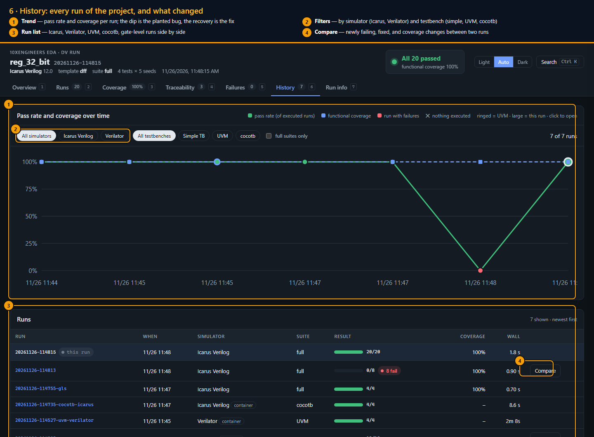

### 7 · Waveform viewer: protocol decoder and transaction table
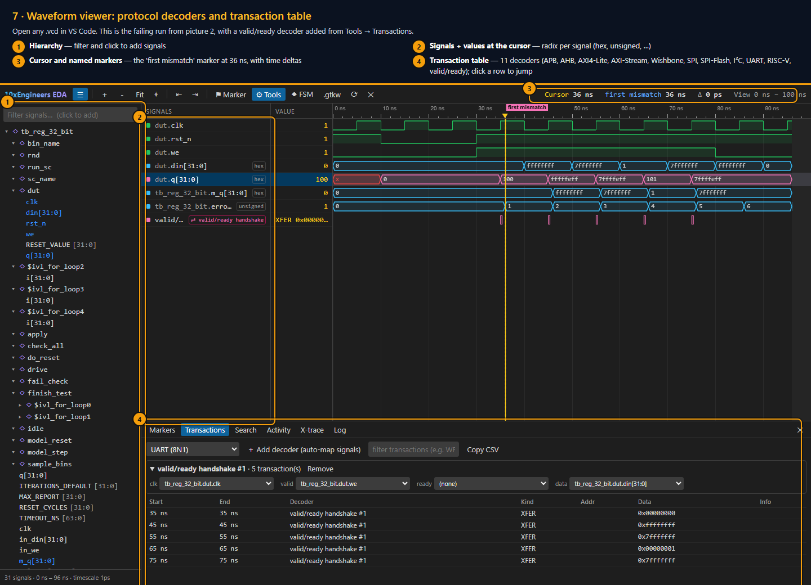

### 8 · X-trace: from an X to the line that causes it
A second small design (an unreset register in a sub-module, fed by a testbench input that starts as X). The trace walks 8 steps through the hierarchy to the cause.
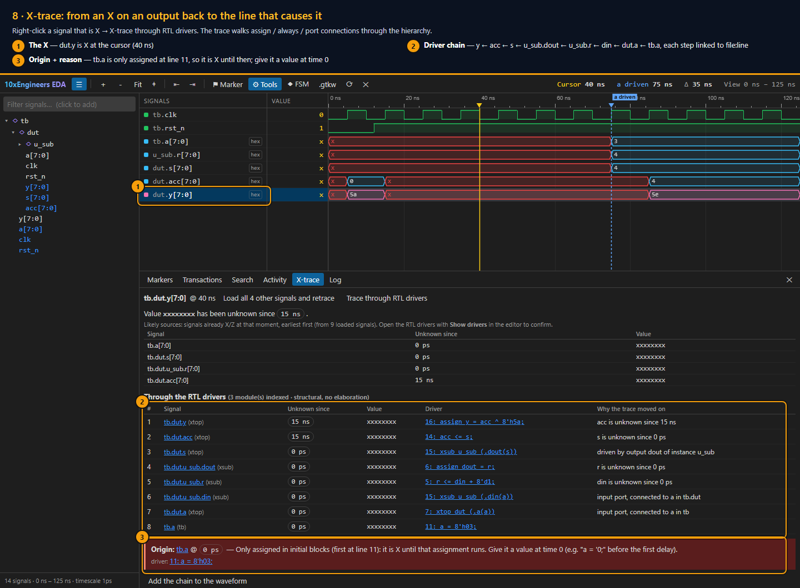

### 9 · UVM architecture of the generated testbench
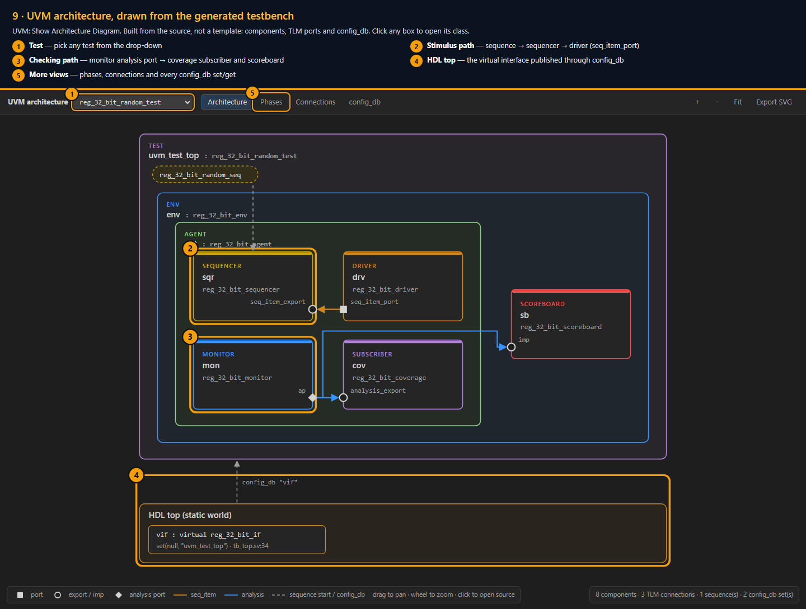

### 10 · Sign-off
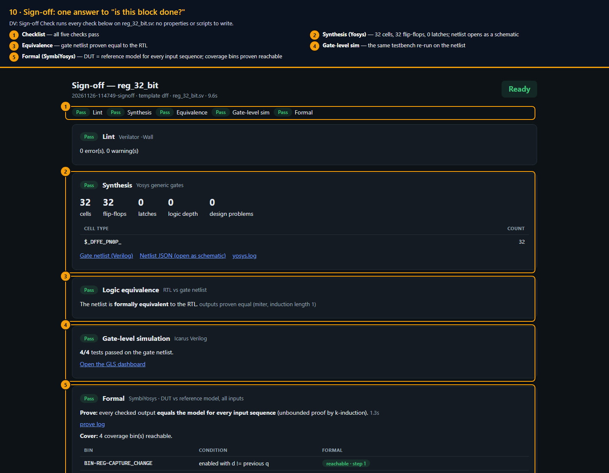

### 11 · Mutation testing
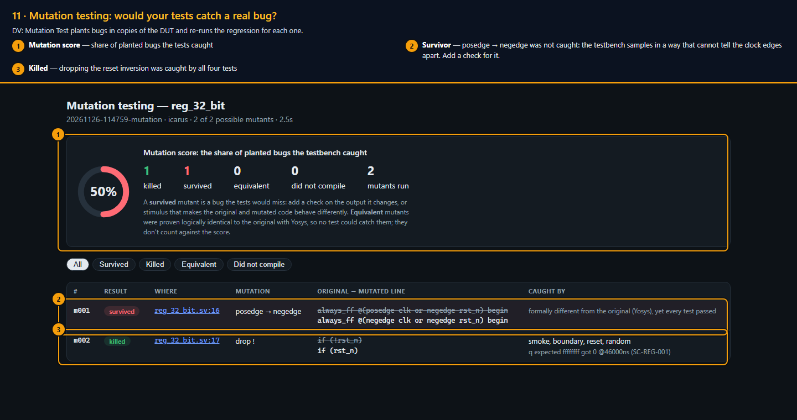

### 12 · The Excel test plan, inside VS Code
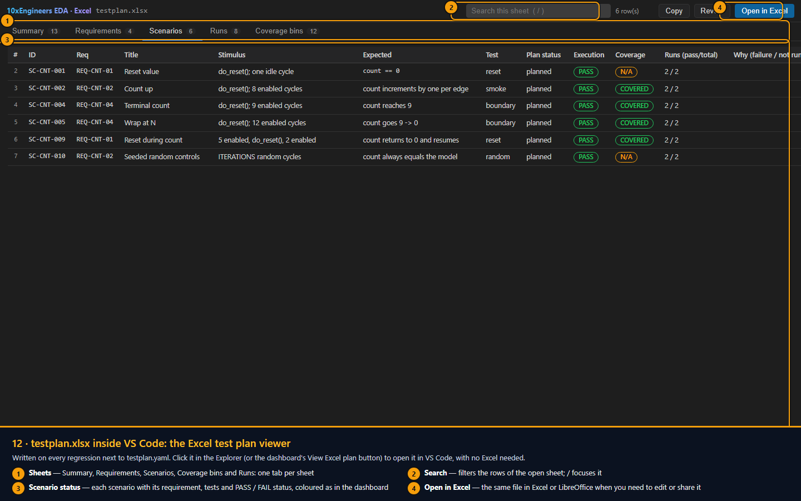

### 13 · First run on a new machine (Docker)
The same picture as in [Get started](../README.md#get-started-in-4-steps): download once, smoke test, run.

#### The design
```systemverilog
// 32-bit write-only register
//
// Software/bus side can only write it: when we = 1 on a rising clock edge, din is stored.
// There is no read-back path; the stored value drives hardware through q.
// Active-low asynchronous reset loads RESET_VALUE.
module reg_32_bit #(
    parameter logic [31:0] RESET_VALUE = 32'h0000_0000
) (
    input  logic        clk,
    input  logic        rst_n,   // asynchronous reset, active low
    input  logic        we,      // write enable
    input  logic [31:0] din,     // write data
    output logic [31:0] q        // register value (to hardware, not readable by software)
);

    always_ff @(posedge clk or negedge rst_n) begin
        if (!rst_n)
            q <= RESET_VALUE;
        else if (we)
            q <= din;
        // we = 0: hold the current value
    end

endmodule
```

---

## Quick start: the 5-minute demo

1. Install and start **Docker** (see [Get started](../README.md#get-started-in-4-steps)).
2. Run `Ctrl+Shift+P` → **10xEngineers EDA: Create Demo Project** and pick a folder.
3. Press the first button of the tour. On the first run the tools image downloads by itself (progress in the Output panel); nothing to build.

The demo opens with a **Demo Tour**: one button per feature, and each step says what it does and why it matters.

| # | Step | What you see |
|---|---|---|
| 1 | Check the toolchain | Every simulator and tool found, with versions |
| 2 | See what one RTL file turned into | `dvflow.json`, `tb/`, `uvm/`, `cocotb/` and a test plan, generated from `adder.sv` |
| 3 | Run a regression | 12 self-checking runs; `testplan.yaml` and `testplan.xlsx` filled in |
| 4 | Explore the dashboard | Click a run for its log and waveform; Coverage, Traceability, History, Ctrl+K |
| 5 | Code coverage | Verilator line, branch, expression and toggle coverage, and what no test exercised |
| 6 | UVM | The architecture diagram, then UVM on Verilator with no license |
| 7 | cocotb | The same scenarios checked in Python |
| 8 | Plant a bug | The regression fails; triage names the output, the input and the time, and the waveform jumps there |
| 9 | Formal proof | The bug is found for *all* inputs, with a counterexample waveform |
| 10 | Fix and confirm | History → Compare shows the tests as *fixed* |
| 11 | Mutation testing | Bugs planted automatically, and how many the tests catch |
| 12 | Sign-off | Lint, synthesis, equivalence, gate-level simulation and formal in one checklist |

The same tour is the first step of **Help → Welcome → 10xEngineers EDA: from one RTL file to a verified design**.

---

## Step by step with your own design

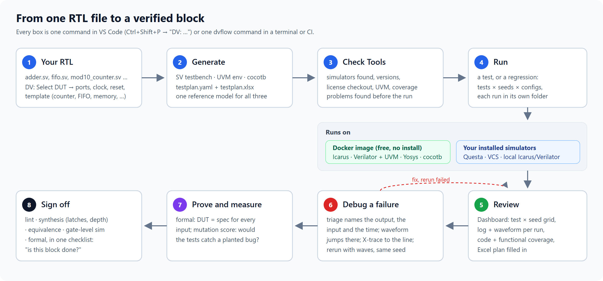

| Step | Do this | You get | Why it matters |
|---|---|---|---|
| 1. Describe the DUT | Open your `.sv` file → **DV: Select DUT**. Pick the top module; press **Cancel** at *Dependencies* if the file is self-contained; pick the template marked *suggested from the RTL*. | `dvflow.json`: ports, clock and reset, template, behaviour spec | The expected results come from the spec, not your RTL, so an RTL bug can't hide in the checker |
| 2. Generate | **DV: Generate Testbench** → **All: SV + UVM + cocotb** | `tb/`, `uvm/`, `cocotb/`, `testplan.yaml` with stable REQ / SC / BIN IDs | Three testbenches and a test plan in seconds, all with the same scenarios |
| 3. Check the tools | **DV: Check Tools** | Installation and license checks per simulator | Problems found before the first run, not during it |
| 4. Run | **DV: Run Test** (pick **Simple**, **UVM** or **cocotb**, a simulator and the tests) or **DV: Run Regression** (a suite × seeds) | Every run in its own folder with log, waves, `results.json`, `junit.xml`; the test plan and Excel updated | Reproducible by seed; every requirement gets evidence |
| 5. Review | **DV: Open Dashboard** | Pass rate, coverage, test × seed grid, run panel with log and waveform, traceability, failures, history, compare | One page for status, gaps and changes |
| 6. Close coverage | Run again with **code coverage** on (Verilator or Questa); read Coverage → *uncovered DUT lines* | Functional bins per test, code coverage of the DUT, uncovered lines with links | Shows exactly which conditions no test reached |
| 7. Debug a failure | Dashboard → Failures or the red cell → run panel. A failing test already has its waveform: by default every failure is re-run once with the same seed and `waves.vcd` (passing runs stay fast, with no dump). **Rerun with waves** for any other run | The failing check, expected vs actual, triage hypotheses, waveform at the failure time | From "a test failed" to the cause in a few clicks |
| 8. Prove it | **DV: Formal Proof** | DUT = reference model for every input sequence; reachable / unreachable coverage bins; a counterexample if not | Covers the cases no test thought of; unreachable bins can be waived with a proof |
| 9. Check the netlist | **DV: Gate-Level Simulation** (or **DV: Synthesize DUT**) | Cells, flip-flops, **latches**, logic depth; RTL ≡ netlist; the testbench re-run on the netlist | Catches synthesis-simulation mismatches and accidental latches early |
| 10. Rate the testbench | **DV: Mutation Test** | Mutation score: planted bugs caught, missed, equivalent | Proves the tests would catch bugs, not just that they pass |
| 11. Sign off | **DV: Sign-off Check** | One checklist (lint, synthesis, LEC, GLS, formal) plus a dashboard panel | One answer to "is this block done?" |

From a terminal or CI, every step has a command; see [dvflow command line](#dvflow-command-line).

---

## Feature guide (new in 0.7 – 0.10)

### Open-source toolchain in Docker
One pinned image, `ghcr.io/engineerwaseem121-dot/eda-tools:1.0.0`: **Icarus 12, Verilator 5.054 with UVM, Yosys, SymbiYosys (Z3, Boolector), GHDL, Python with cocotb 2.1 and pyuvm, make**. Exact versions are in [container/image.json](../container/image.json); licences in [container/THIRD_PARTY_NOTICES.md](../container/THIRD_PARTY_NOTICES.md).

- **Downloads by itself** on the first run that needs it, with progress in the Output panel. Two VS Code windows never download it twice, and **Cancel** stops the download.
- **Checked before use:** every new image runs a smoke test (Icarus, Verilator, UVM, Yosys, SymbiYosys, GHDL, cocotb). If the test fails, the image is not used and the last working one is kept.
- **Updates:** once a day it looks for a newer compatible tag; **10xEngineers EDA: Update Simulation Tools** does it now. Turn off with `tenxDebug.toolchain.autoUpdate`.
- **Your files stay where they are:** the project folder is mounted at the same path, so logs, waveforms, `+args`, seeds and paths with spaces all work.
- **Modes** (`tenxDebug.toolchain.mode`): `auto` (default; installed tools first, Docker fills the gaps), `container` (always Docker), `local` (never Docker).
- Every run logs the image tag and tool versions; the status bar shows them too. **Open Terminal in Container** gives a shell with all the tools.
- Command line: `dvflow toolchain status | pull | update | check | smoke`.

### UVM on Verilator (no license)
**DV: Run Test → UVM testbench → Verilator.** Generated UVM environments compile on Questa, VCS and Verilator; covergroups are guarded with `` `ifndef VERILATOR ``. Each UVM run gets the full dashboard: scoreboard check counts, log, waveform, scenarios and requirements. Covergroup coverage needs Questa or VCS.

### cocotb (Python) testbench
**DV: Generate Testbench → cocotb** writes `cocotb/test_<top>.py`, a Python reference model for each template (adder, counter, up/down counter, register, latch, shift register, pipeline, FIFO, memory; a skeleton for custom), and a Makefile for Icarus or Verilator. **DV: Run Test → cocotb testbench** runs it in the container and opens the dashboard.

### Dashboard
- **Overview:** pass rate, coverage rings, a test × seed grid (click a cell), sign-off and testbench-quality panels
- **Run panel:** log with errors highlighted and searchable; an embedded **waveform viewer** (zoom, pan, cursor values); times in the log jump the waveform cursor; **Rerun with waves**
- **Coverage:** the bin × test heatmap, code coverage per metric, and the uncovered DUT lines
- **History:** pass-rate and coverage trend across every run (filter by simulator and testbench), and **Compare** two runs to see newly failing, fixed and coverage changes
- **Ctrl+K** searches runs, bins, scenarios and requirements

### Code coverage
- **Verilator** (free): line, branch, expression and toggle coverage, merged over all runs, limited to the DUT files, with the uncovered lines listed and an LCOV file you can load into editor highlighting
- **Questa:** UCDBs merged with `vcover` (summary, details, HTML), code coverage of the DUT units and covergroup coverage

### Sign-off: synthesis, gate-level simulation, equivalence, formal
- **DV: Synthesize DUT:** Yosys generic synthesis reports cells, flip-flops, **inferred latches by signal name**, logic depth, and problems (undriven nets, multiple drivers, loops). The netlist opens as a schematic.
- **DV: Gate-Level Simulation:** synthesizes, proves the netlist equivalent to the RTL (structural, or a miter with induction for sequential designs), and re-runs your testbench on the netlist with its own dashboard.
- **DV: Formal Proof:** with no hand-written properties, a harness puts the DUT next to the reference model (`formal/<top>_formal.sv`). SymbiYosys proves every checked output equal for every input sequence, names the failing output with a counterexample waveform, and checks which coverage bins can be reached.
- **DV: Sign-off Check:** lint (Verilator `-Wall`) plus all of the above, giving one checklist report.

Limits: formal skips the pipeline template, latches and sequential designs without a reset. Synthesis uses generic gates (no cell library or timing).

### Mutation testing
**DV: Mutation Test** plants operator, constant and edge mutations in copies of the DUT and re-runs the regression for each. Mutants that survive but are proven logically equivalent by Yosys are reported as *equivalent* and not counted. The report links every survivor to its line.

### dvflow command line
Everything works without VS Code (CI, scripts, servers): `.\dvflow.cmd` / `./dvflow.sh` in a generated project, or `node <extension>/src/dv/cli.js`.

| Command | Does |
|---|---|
| `dvflow init --file adder.sv [--mode all]` | One step from an RTL file to `dvflow.json` and every testbench |
| `dvflow regress --sim icarus --suite full [--cov 1] [--waves 1]` | Regression |
| `dvflow uvm --sim verilator --tests smoke,random --seed 1` | UVM tests |
| `dvflow cocotb --sim icarus` | cocotb tests |
| `dvflow signoff [--steps lint,synth,lec,gls,formal]` | Sign-off checks |
| `dvflow mutate --sim icarus --max 40` | Mutation testing |
| `dvflow toolchain status\|build\|stop` | Docker toolchain |
| `dvflow doctor --sim verilator` | Installation and license checks |

**Seeds.** Run Test, Run Regression, UVM and cocotb, and `--seeds` on the command line, all accept the same syntax:

| You type | Runs |
|---|---|
| `7` | Seed 7 only: exactly the same stimulus again, for debugging |
| `1,5,9` | Those seeds |
| `0:100` | Seeds 0 to 100, both ends included (101 runs per test) |
| `0:100:10` | 0, 10, 20 … 100 |
| `random 50` | 50 random seeds, each recorded so any run can be repeated |
| `1,2,10:20,random 5` | Any mix |

The prompt checks what you type and shows how many runs it means before anything starts.

Exit codes: 0 means everything passed, 1 means failures, 2 means incomplete or a tool error, 3 means a usage error. That makes them usable as CI gates.

---

## Contents
0. [Quick start](#quick-start-the-5-minute-demo) · [Step by step](#step-by-step-with-your-own-design) · [Feature guide](#feature-guide-new-in-07--010)
1. [Waveform viewer + FSM debug](#1-waveform-viewer--fsm-debug): named markers, 11 protocol decoders, search, activity, X-trace, logs, diff, inline RTL values, WaveDrom→SVA, Yosys schematic, lint waivers
2. [Coverage dashboard](#2-coverage-dashboard-code--functional)
3. [Testplan: spec → features → hit / remaining](#3-testplan-spec--features--hit--remaining)
4. [Regression](#4-regression-each-test-in-its-own-directory)
5. [UVM generator](#5-uvm-environment-generator)
6. [UVM-aware SystemVerilog](#6-uvm-aware-systemverilog)
7. [SystemVerilog language tools](#7-systemverilog-language-tools)
8. [RISC-V assembly + linker scripts](#8-risc-v-assembly--linker-scripts)
9. [MCP server for AI agents](#9-mcp-server-for-ai-agents)
10. [Questa setup (Windows / Ubuntu)](#10-questa-setup-windows--ubuntu)
11. [Commands & settings](#11-commands)

---

## 0. DV flow: DUT → self-checking testbench → regression → evidence-backed test plan
**DV: Select DUT** reads your RTL and builds a proposed `dvflow.json`: ports, parameters, clock and reset, the template, and the **behaviour spec**. The reference model is written from that spec, not from the RTL, so an RTL bug cannot also hide inside the checker.

- **Templates**:
  - adders (any width; exhaustive at 8 bits or less)
  - counters 0..N (wrap or saturate, N = 0 and 1 included)
  - up/down counters
  - DFFs, registers and latches
  - shift registers
  - valid/data pipelines (in-order scoreboard with an end-of-test missing-transaction check)
  - custom DUTs with your own model
- **Testbench modes**:
  - lightweight self-checking SystemVerilog: directed smoke and boundary tests, exhaustive and seeded-random tests, a timeout, race-free drive and sample timing, and a single `DVFLOW_RESULT PASS|FAIL` line
  - UVM, with the same scenario IDs and the same reference model in the scoreboard
  - or both side by side
- **Simulator adapters**:
  - **Icarus Verilog**, validated
  - **Questa**: build and elaborate validated; simulation needs a license
  - **VCS**: implemented, not yet validated

  Each adapter reports its capabilities. Unsupported metrics are shown as *unsupported* and never count towards totals.
- **Regression**:
  - suites, parameter sweeps and repeatable seeds
  - each run is tagged with revision, simulator version, flags, parameters and seed
  - cancellation and timeouts keep partial logs
  - every failure gets `runs/<id>/failures/<test>/<seed>/` with `triage.md` (first actionable error, classification, expected vs actual, labelled hypotheses), the logs, `command.txt` and `rerun.cmd`/`rerun.sh`
- **Test plan** (`testplan.yaml`): stable REQ / SC / TEST / CHK / BIN IDs. Your edits are preserved; only the results block is rewritten after each run.
- **Dashboard** (standalone HTML, also shown in the editor):
  - totals by test, seed, configuration and simulator
  - coverage by type and by requirement
  - hit / unhit / waived / unsupported / unavailable filters, with per-test/seed attribution
  - a suggested stimulus and category for every unhit item
  - failure signatures and a comparison with the previous run
- **Also**:
  - SVA templates for reset, hold, wrap and illegal values
  - waivers with reviewer and expiry
  - JUnit and JSON export with CI exit codes
  - a bug-injection demo
  - opt-in AI drafting and summaries (off by default; it asks before sending anything)

See `dvflow-demo/README.md` for the walkthrough.

### Simulators: QuestaSim (primary), Verilator, GHDL, Icarus, VCS
Choose the simulator in either place:
- the extension: **DV: Select Simulator** (stored in `dvflow.json`)
- per command: `make … SIM=questa|verilator|ghdl|icarus|vcs`

`QUESTA_BIN`, `VERILATOR_BIN`, `GHDL_BIN`, `ICARUS_BIN` and `VCS_BIN` accept either the installation folder or the bin folder. If none is set, the tools are found through `~/.dvflow/simulators.json`, then `PATH`. The extension and `make` read the same settings.

Licenses are inherited from your environment by default. **DV: Configure Simulators** stores a *per-user* license file or server in `~/.dvflow/simulators.json`. That value is never written to generated files and is redacted from every log, report and message.

```
make check-tools SIM=questa QUESTA_BIN=/path/to/questa  # tools found? + batch smoke sim (license) + UVM/coverage when enabled
make run     SIM=questa TEST=adder_smoke SEED=42
make run     SIM=verilator TEST=adder_smoke SEED=42
make run     SIM=ghdl TEST=counter_tb                    # VHDL ("language": "vhdl" in dvflow.json)
make retry                                               # after fixing a path or license: same simulator, tests, seeds; nothing regenerated
```

When a run fails, it reports the **failing stage**, the **simulator's own message**, and the **exact next action**:

| Failure | What you see |
|---|---|
| Missing executable | Which binary is missing and where to set `QUESTA_BIN` (or the extension setting) |
| License checkout failed | Status **LICENSE**, kept separate from test FAIL. The vendor diagnostic is shown with license details redacted, plus a pointer to the per-user license setting or your license administrator |
| Compile / elaboration / test failure | A link to the first actionable error in the saved log |
| Unsupported feature | The requested feature and the selected simulator, and which other configured simulator supports it |

### 10xEngineer RTL Regression Explorer (Test Explorer)
- Every `dvflow.json` appears in VS Code's **Testing** view as **suites → tests → configuration · seed** before anything runs.
- The latest `runs/<id>/results.json` decorates each item with its state, duration and an inline failure message (expected vs actual as a diff, linked to `triage.md`). Runs started from a terminal, a task or a CI copy show up as well.
- **License and tool errors are shown as *errored*, never as test failures.**
- **Formal (SymbiYosys)**: list your `"formal"` entries in `dvflow.json`.
  - The verdict is kept as SymbiYosys reports it: *pass*, *counterexample found*, *engine could not decide*, *timeout* or *error*. It appears in the item description, in a filterable `verdict:*` tag, and in the message.
  - Only a real counterexample offers **Open Counterexample in 10xEngineers EDA**, which opens the VCD in the waveform viewer beside the failing property.
  - If the trace was recorded on another machine and isn't present here, it says so instead of opening an empty view.
- The **`dvflow` task type** runs `dvflow regress --ci` / `doctor` / `retry` in a terminal. `tb.sv:128:7` locations and SymbiYosys "Writing trace to VCD file" lines are clickable.

## 1. Waveform viewer + FSM debug
**Open any `.vcd` file** to view it as a waveform. You can double-click it in the Explorer, or use the **Waveforms** view in the 10xEngineers EDA sidebar.

**`.fst`, `.lxt`, `.lxt2` and `.ghw` also open.** They are converted to VCD on the fly with GTKWave's `fst2vcd` / `lxt2vcd`, which must be on PATH: install GTKWave on Windows, or `sudo apt install gtkwave` on Ubuntu. GHW has no standard converter. Either dump `--vcd`/`--fst` from GHDL, or set your own command in `tenxDebug.wave.converters`. If a converter is missing, you get a message explaining how to fix it.

| Action | How |
|---|---|
| Add signals | Click them in the browser on the left; **+** on a scope adds all its signals. `A` focuses the filter (configurable). |
| Zoom | `Ctrl + wheel`, `=` / `-`, drag across the waves, `F` to fit, `Home` / `End`. Keys, amount and target are configurable. |
| Cursor / **named markers** | Click sets the cursor. `M`, `Shift + click` or **⚑ Marker** add as many markers as you like. Name them in **Tools → Markers**, which shows each marker's time, Δ to the cursor and Δ to the previous marker. Double-click a marker line to rename it; `N` / `Shift+N` jumps between markers. |
| Jump to edges | `←` / `→` on the selected signal (on a decoder row they jump between transactions) |
| Radix, FSM decoding, style | Right-click a signal: radix (hex, bin, oct, unsigned, signed, ASCII, UTF-8, **float** 16/32/64), color from the palette, stroke 0.5–3 px, fill on/off, renderer **bus** or **analog step / linear** |
| Import GTKWave layout | **.gtkw**: signals, radix flags and markers from a GTKWave save file |
| Shared starting view | Put a **`<dump>.tenxview.json`** next to a waveform (rows, decoders, markers, cursor, tools tab) and it opens that way for everyone. If the file changes, it replaces your saved view. The examples ship one per waveform. |

**⚙ Tools panel** (bottom):
| Tab | What it does |
|---|---|
| **Markers** | named markers, deltas, rename, move to cursor, delete |
| **Transactions** | **11 protocol decoders**: UART (8N1, auto bit-time), SPI (CPOL/CPHA), **SPI-Flash** (on top of SPI: one row per chip-select frame with opcode name, address, data and status bits; flags a program/erase without WREN), I²C, APB, AHB-Lite, AXI4-Lite, AXI-Stream, Wishbone, **RISC-V instruction trace** (clk/valid/pc/insn → disassembly of RV32I, M, Zicsr and compressed instructions, with branch taken / not-taken), valid/ready. Signals are mapped from their names automatically and can be adjusted per role. Each decoder adds a row of transaction boxes to the waveform and fills a filterable **transaction table**, which you can click to jump and copy as CSV. Errors (PSLVERR, NACK, SLVERR, framing) are shown in red. |
| **Search** | multi-signal pattern search, for example `valid && ready && data == 8'hFF` or `state != 0 && err`. It lists every time the expression becomes true; `F3` steps through the matches. |
| **Activity** | switching activity per signal (value changes, bit toggles, toggles per bit) over the visible range, the whole run, or between the first and last marker |
| **X-trace** | for a signal that is X at the cursor: when it became unknown, and which signals were already X/Z at that moment. **Trace through RTL drivers** walks the X backwards through your source (`assign`, `always` blocks including their if/case conditions, and instance port connections, up and down the hierarchy) to the signal where it starts. Each step links to its file and line, and the result explains the origin, for example a register with no reset, an input port the parent leaves unconnected, a testbench variable not assigned until line N, or an explicit `'x`. |
| **Log** | load a cocotb / UVM / Questa / `$display` log. Timestamped lines (`1234.00ns INFO …`, `UVM_ERROR … @ 120:`, `Time: 50 ns`, `@66000ns`) become ticks on the waves; click a line to jump to that time. |

- **Inline values in the RTL.** While a waveform is open, every signal declaration in open Verilog/SystemVerilog/VHDL editors shows its value at the cursor, for example `⟵ count=4'h9 @120 ns`. Toggle with *Waveform: Toggle Inline Signal Values*.
- **Cross-probe.** Right-click a signal → *Go to declaration in RTL*. Turn on `tenxDebug.wave.crossProbe.followWaveformSelection` and selecting a signal reveals its declaration without taking focus. A name declared in several modules that the scope cannot resolve is reported as ambiguous, never guessed.
- **Theme and contrast.** The viewer follows light, dark and high-contrast themes live, and every trace colour is held to a contrast floor against the background (`tenxDebug.wave.theme.minContrast`, default 3:1, the WCAG minimum for non-text graphics).
- **Large files.** VCDs are read in 4 MiB chunks, and signal data is sent to the viewer only for the rows you show. `tenxDebug.wave.maxFileMB` (default 256) gives a clear error instead of running out of memory.
- **Default editor.** If your editor (for example a VS Code fork) opens a `.vcd` as text, the extension asks once whether to make the waveform viewer the default for `*.vcd`. An existing association is left alone.
- **Waveform diff** (*Waveform: Compare Two Waveforms*, or right-click a dump): signals are matched by hierarchical path, and the dumps may have different timescales.
  - Signals that differ are listed with their first divergence, earliest first.
  - Picking one opens both dumps side by side, at that time, with a marker.
- **Settings** (`tenxDebug.wave.*`, same names as WaveTrace):
  - `display.defaultTraceStyle` {color, fill (0 = off), radix, renderer line/bus/step/linear, strokeWidth in 0.5 px steps}
  - `display.disableGpu`
  - `keyboard.addSignal / reload / zoomAmount / zoomStart / zoomEnd / zoomFit / zoomIn / zoomOut / zoomTarget`
  - `mouse.reverseScrolling / zoomAmount / zoomTarget (mouse/center/cursor)`
  - `theme.palette`
  
  Changes apply to open viewers immediately.

- **State signals are decoded automatically.** 10xEngineers EDA reads the state machines in your RTL, so `state` shows `MAIN_GREEN`, `ALL_RED`, … with one colour per state.
- The **◆ FSM** panel draws the state diagram and highlights the state at the cursor. It also shows **FSM coverage for this simulation**:
  - states visited and transitions taken
  - states never visited
  - transitions never exercised
  - transitions that are **not in the RTL**
  - illegal encodings
- Click a state or an arc in the diagram to jump the cursor to the moment it happened.
- **Live reload**: when the simulator rewrites the VCD, the view updates and keeps your signals and zoom.

**FSM diagrams from source.** Open a `.sv` file and click the `◆ FSM` CodeLens above `case (state)`, or use the editor title button.
- Nodes can be dragged.
- Diagrams export to SVG, Mermaid or DOT.
- Unreachable, dead-end and unhandled states, duplicate encodings and a missing `default` are reported in the Problems panel.

### WaveDrom timing diagrams → SystemVerilog assertions
Open a `.wavedrom` / `.wdjson` file, or any JSON with a `"signal"` array; JSON5 with comments and unquoted keys also works. Click **▶ WaveDrom preview + SVA**.
- The diagram is drawn by 10xEngineers EDA's own renderer: clocks, levels, data, X/Z, groups, and nodes with spline or sharp edges.
- **Assertions are generated from the `node` letters and `edge` arrows.** Each node becomes an event at its slot: 0→1 `$rose`, 1→0 `$fell`, X→data `!$isunknown`, data→data `$changed`, a level `s` / `!s`.
- **The delay is the exact cycle distance between the nodes**, taking `period` and `phase` into account.
  - `a~>c`, `a->c`, `a-|>c` and `a|->c` produce `assert property (EV(a) |-> ##N EV(c))` plus a cover.
  - `a<->c` adds the reverse `$past` check.
  - Undirected `a~c` produces a cover only.
  - An edge label `[1:3]`, `1..3`, `##2`, `<=4` or `$` gives a window instead of the exact delay.
- The clock (the `p`/`n` lane) and the reset (`rst_n`, `presetn`, …) are detected automatically and give `disable iff`.
- **Export .sv** writes a bindable checker module.

Example: `{"signal":[{"name":"req","wave":"01..0.","node":".a..b."},{"name":"ack","wave":"0.1.0.","node":"..c.d."},{"name":"data","wave":"x.==.x","node":"..e.f."}],"edge":["a~>c","c->e","b-|>d"]}` gives
`$rose(req) |-> ##1 $rose(ack)`, `$rose(ack) |-> !$isunknown(data)` and `$fell(req) |-> $fell(ack)`.

### Schematic from a Yosys netlist + "What drives this?"
- *Schematic: Open Yosys JSON Netlist* shows any `write_json` output as a left-to-right schematic. Registers are purple, sub-modules dashed, and bus width sets the line thickness.
- *Schematic: Synthesize with Yosys and Show* runs `read_verilog -sv; prep -top; write_json` for you when `yosys` is installed.
- Double-click a cell to jump to its RTL line (from the Yosys `src` attribute).
- **What drives this?** and **What does it drive?** highlight the fan-in or fan-out cone of the selection, stopping at the first register. They work from the schematic, or from the editor: put the cursor on a signal name, right-click, then *Schematic: What Drives This?*

### Lint findings + waivers
Linter output (slang / Verilator / Icarus) and the FSM checks appear in the Problems panel. Each finding has quick fixes:
- **Waive here**, which records the rule, file, line text, reason, owner and optional expiry in `.tenx-waivers.json`
- **Waive in this whole file**
- **Add an inline waiver comment**: `// tenx-lint-waive RULE: reason`

Waived findings are hidden. Expired waivers count again. *Lint: Open Waivers File* lets reviewers check them.

## 2. Coverage dashboard (code + functional)
Run **10xEngineers EDA: Open Coverage Report**. It accepts:
- a Questa **`.ucdb`**: `vcover report` runs for you, and selecting several UCDBs merges them
- a `vcover report` text file
- **LCOV** `.info`
- **Verilator** `coverage.dat`
- JSON

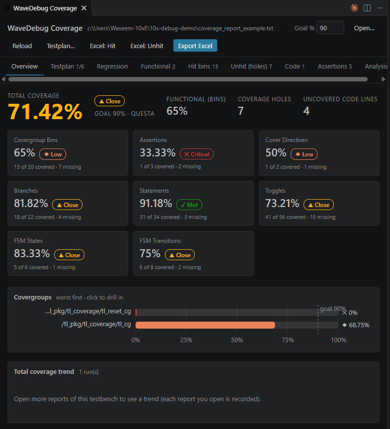

| Tab | What you get |
|---|---|
| **Overview** | Total vs goal, a tile per metric (statements, branches, conditions, toggles, FSM, covergroup bins, assertions, directives), covergroup ranking, trend across runs |
| **Testplan** | Per spec feature: covered / partial / not covered, hit and remaining items |
| **Regression** | Pass/fail of every test and seed, with log and directory links |
| **Functional** | Covergroup → coverpoint / cross → bins, with hit counts |
| **Hit bins** | Every bin that was hit |
| **Unhit (holes)** | Every bin not yet hit, ranked by priority (quick wins first) |
| **Code** | Per instance and per file, with clickable uncovered lines |
| **Assertions** | Failed, passed and vacuous assertions; cover directives |
| **Analysis** | What to do next, plus generated constraints that target the holes |

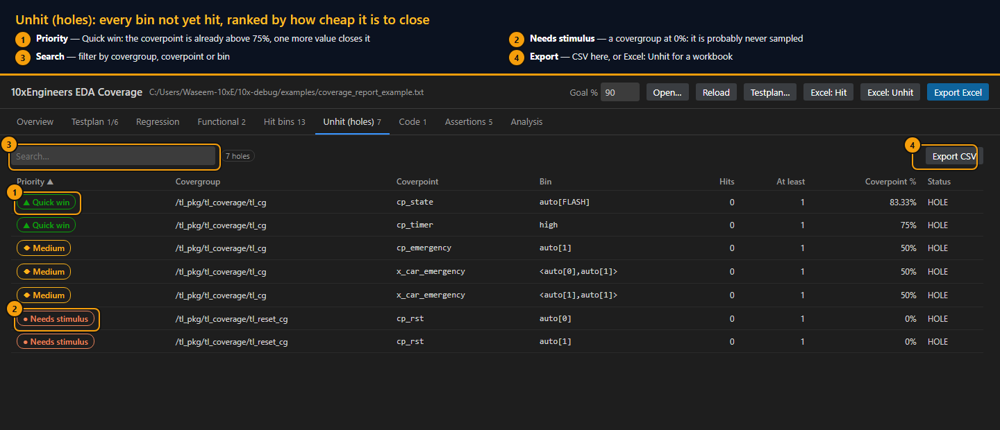

**Excel export** produces real `.xlsx` files. There are three buttons:
- **Excel: Hit**: only hit bins and hit testplan items
- **Excel: Unhit**: holes, remaining testplan items and uncovered code
- **Export Excel**: the full workbook (Summary, Verification Plan, Regression, Hit bins, Unhit bins, Plan items, Coverpoints, All bins, Instances, Assertions, Cover directives)

Status cells are coloured, headers are frozen and every sheet has filters.

**View the workbooks without Excel.** Any `.xlsx` (the test plan, coverage exports, your own) opens in a VS Code tab: run **DV: View Test Plan (Excel) in VS Code**, click **View Excel plan** after generating, or right-click an `.xlsx` → **Excel: View in VS Code**. You get:
- one tab per sheet
- search (`/`)
- sorting by any column
- coloured PASS / FAIL / HOLE / NOT RUN cells
- clickable file and run-folder paths
- **Copy** (pastes into Excel or Google Sheets)
- **Open in Excel**

The tab refreshes by itself when a regression rewrites the file. It is read-only, and the extension never changes which app opens `.xlsx` by default.

**In the editor**: click **Highlight coverage in editor**. Lines that never executed are shaded red, covered lines get a green bar, and hovering shows hit counts. File coverage also appears in VS Code's **Testing** panel.

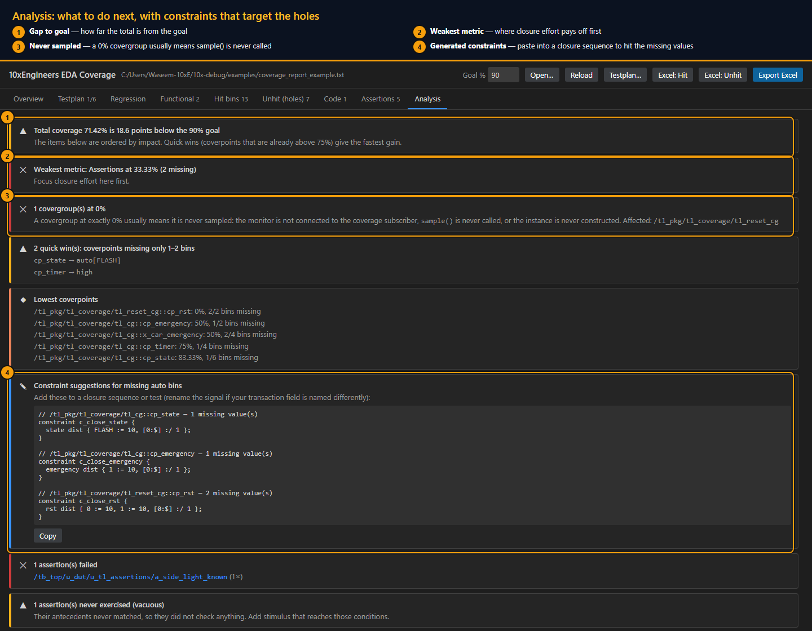

## 3. Testplan: spec → features → hit / remaining
1. **Extract the features.** Right-click a `.md` or `.txt` specification and choose **Extract Testplan from Spec**. Every *shall / must / should* sentence becomes a feature. The command writes `<spec>.testplan` (YAML) and `<spec>_testplan.xlsx`.
2. **Map each feature** to coverage items. Wildcards `*` are allowed.
   ```yaml
   features:
     - id: ALU-OVF
       name: Signed overflow
       description: ovf shall flag signed overflow of ADD and SUB
       coverage: [alu8_cg::cp_ovf_kind, cover:c_add_overflow]   # covergroup::coverpoint[::bin]
       assertions: [a_ovf_only_arith]                           # must pass non-vacuously
       tests: [alu8_closure_test]                               # must pass in the regression
   ```
   `.testplan` files get **autocomplete and validation** from the bundled schema (install *YAML by Red Hat*). A CSV vplan with the columns `ID, Feature, Description, Priority, Owner, Coverage Items, Goal` also works.
3. **Load it.** Use **Testplan…** in the dashboard, or put it next to the report and it loads automatically. Each feature shows **Covered / Partial / Not covered / Unmapped**, with the hit and remaining items. The sidebar shows the same.

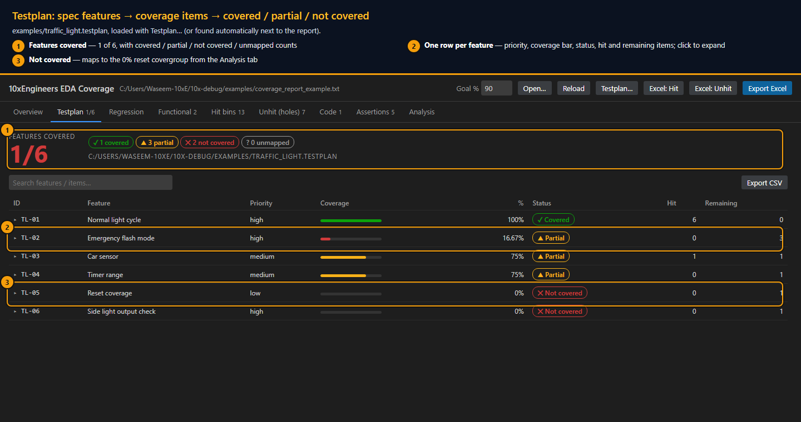

## 4. Regression (each test in its own directory)
Describe the regression in `regression.json`. It is schema-validated, so you get autocomplete.
```json
{ "name": "my regression", "parallel": 2, "testplan": "verification.testplan",
  "jobs": [ { "name": "alu8", "dir": "verif/alu8",
              "tests": [ { "name": "alu8_closure_test", "seeds": 2 }, { "name": "alu8_random_test", "seeds": 3 } ] } ] }
```
Then run **10xEngineers EDA: Run Regression**:
- Each job is compiled once.
- Every test × seed runs in its own folder: `regression_runs/<timestamp>/<job>/<test>/seed_<n>/` with `transcript.log`, `cov.ucdb` and `waves.vcd`.
- PASS/FAIL is read from the UVM report (UVM_ERROR, UVM_FATAL, TEST PASSED).
- The UCDBs are merged (`vcover merge`) and the dashboard opens with the **Regression** and **Testplan** tabs filled in.

## 5. UVM environment generator
Run **10xEngineers EDA: Generate UVM Environment (from DUT)**, or right-click an RTL file. It's a 6-step wizard:
1. Choose the DUT. Its ports and parameters are parsed (ANSI and non-ANSI), and the **clock, the reset and its polarity, and valid/ready handshakes are detected**.
2. Choose the prefix.
3. Choose **Active** or **Passive** (switchable at run time with `+PASSIVE`).
4. Choose the components: coverage, scoreboard, SVA, Questa scripts.
5. Choose the output folder.
6. Choose the source list.

Generated:
- interface with clocking blocks
- config object
- sequence item
- random, corner, idle and **reset** sequences
- driver and monitor
- coverage subscriber
- scoreboard with a `predict()` reference-model hook
- SVA checker
- base, random and closure tests
- package and `tb_top`
- `files.f`
- `run.do`, `Makefile`, `run.sh` and `run.bat` (Windows and Linux)

Supporting commands:

| Command | What it does |
|---|---|
| **UVM: Validate Testbench** | Checks the source list, package includes and imports, every expected component (driver, monitor, agent, env, test, item, sequencer, scoreboard, coverage), the interface, `tb_top` (`run_test`, vif `config_db`, DUT instance), leftover placeholders and UVM lint, then reports **Validation PASSED / FAILED** |
| **UVM: Update Source List** | Rebuilds `files.f` (or `src_files.list`) in compile order. DUT files are found by following the instances in `tb_top` |
| **UVM: Generate Sequence Item** | Builds a seq-item class from fields such as `addr:32, data:32, write:1, burst:enum{SINGLE,INCR}` |
| **UVM: Generate Basic Sequence** | Builds a sequence for any seq-item in the workspace |
| **Run Questa Simulation** | Pick the test and batch or GUI mode. Afterwards the dashboard and waves open |

## 6. UVM-aware SystemVerilog

- **UVM Verification Hierarchy** view:
  - each test's **component topology**, worked out from `type_id::create` calls, with **factory overrides applied** (overridden components are marked)
  - ports and their `connect()` calls
  - `uvm_config_db` fields with every set and get
  - factory overrides
  - classes grouped by kind
- **UVM: Show Class Graph**: an interactive inheritance graph.
- **config_db hover**: hover a `get` to see the `set` calls that can provide it, or a `set` to see the `get` calls it reaches.
- **Override hover**: hover a `set_*_override` call to see which components it changes in each test.
- **UVM lint** with quick fixes and `// 10x-waive <RULE>` waivers:
  - missing or wrong factory registration, or the wrong macro kind
  - a constructor the factory can't call
  - missing `super.build_phase`
  - unbalanced objections
  - an ignored `randomize()` result
  - an unchecked `config_db::get`
  - a component built with `new()` instead of `type_id::create`
  - a missing `uvm_macros.svh`
  - a `get` with no matching `set`
- **Clickable logs**: in `*.log`, `transcript` and terminals, `file(line)` and `file:line` open the source, even when the log was written on another machine. `uvm_test_top.env.sb` opens that component's class.

## 7. SystemVerilog language tools
- Syntax highlighting for Verilog, SystemVerilog, UVM and SVA, plus outline, breadcrumbs, workspace symbols, go-to-definition and find references.
- **Smart completion**:
  - members after `.` (class fields and methods, interface signals)
  - package and class items after `::`
  - macros after `` ` ``
  - a **complete module instantiation in one step**
- **Hover** shows what a macro expands to (`` `define `` and UVM macros), FSM state details and config_db cross-references.
- **Inlay hints** show port and parameter names on positional connections.
- **Instance repair** offers to connect missing ports, convert ordered connections to named ones, and expand `.*`. Ports connected twice and unknown ports are flagged.
- Right-click a signal for **Show Drivers**, **Show Loads**, or **Show Assertions & Coverage Using Signal**.
- **Design Hierarchy** view: instances and parameter overrides, built from the source.
- **Formatter**: Format Document and Format Selection fix indentation and trailing blanks **only**. Every result is checked to change whitespace only. Hand-aligned continuation lines, `` `define `` bodies, comments, strings and protected regions are never touched.
- **Diagnostics**:
  - **slang** (if installed) gives full semantic errors (undeclared names, unknown types, members and ports) using your `files.f`
  - Verilator and Icarus are supported as alternatives
  - FSM checks
- Snippets for RTL, SVA, covergroups and every UVM component and phase.

## 8. RISC-V assembly + linker scripts
`.s`, `.S` and `.asm` files get:
- **RV32GC / RV64GC** highlighting: base I, M, A, F, D, C, Zicsr, Zifencei, privileged and pseudo-instructions
- registers (`x0–x31`, ABI names, `f` registers), CSRs, `%hi`/`%lo` relocations, local labels (`1b`/`1f`) and assembler directives
- `#`, `//` and `/* */` comments, with auto-closing brackets, quotes and comments
- **Instruction completion** with operand snippets, plus register, CSR, label and directive completion
- **Hover** documentation for every instruction

Linker scripts (`.ld`, `.lds`) are highlighted too.

## 9. MCP server for AI agents
The extension ships an MCP server, so Claude Code, Cursor, Copilot and other agents can query your verification data. Its tools:
- `coverage_summary`
- `coverage_holes`
- `testplan_status`
- `extract_testplan_from_spec`
- `extract_fsms`
- `module_ports`
- `uvm_structure`
- `uvm_lint`
- `generate_uvm_env`

VS Code 1.101+ registers it automatically. For other clients, run **10xEngineers EDA: Copy MCP Server Config** and paste the result into `.mcp.json` or `~/.cursor/mcp.json`. The server runs on the editor's own runtime, so no Node.js install is needed.

## 10. Questa setup (Windows / Ubuntu)
10xEngineers EDA finds Questa or ModelSim automatically. It looks in PATH, `QUESTA_HOME`, `C:\questasim64_*`, Intel `questa_fse`, `/opt/questasim*`, `~/intelFPGA*` and similar locations. You can also set it yourself with **10xEngineers EDA: Configure Questa / ModelSim Path**, which writes `tenxDebug.questa.path`. Examples:
- `C:\questasim64_2024.1\win64`
- `/opt/questasim/linux_x86_64`

Simulation needs a valid Questa license. If the license variable was set with quotes, 10xEngineers EDA strips them when it launches `vsim`.

## 11. Commands
All commands are under **10xEngineers EDA** in the Command Palette (`Ctrl+Shift+P`).

| Area | Commands |
|---|---|
| Start here | Create Demo Project, Open Demo Tour, Set Up Open-Source Toolchain, Open-Source Toolchain: Status / Open Terminal in Container |
| DV flow | DV: Select DUT, Generate Testbench (SV / UVM / cocotb / All), Generate Test Plan, Check Tools, Run Test, Run Regression, Open Dashboard, Rerun Failed Test, Export Test Plan to Excel |
| Sign-off | DV: Sign-off Check, Synthesize DUT, Gate-Level Simulation, Formal Proof |
| Quality | DV: Mutation Test |
| Waves / FSM | Open Waveform, Show FSM Diagram, Copy FSM as Mermaid, Rescan FSMs |
| Coverage | Open Coverage Report, Show Coverage Dashboard, Toggle Coverage Highlighting, Load Testplan, Extract Testplan from Spec |
| Regression / Questa | Run Regression, Run Questa Simulation, Configure Questa Path |
| UVM | Generate UVM Environment, Show Architecture Diagram, Validate Testbench, Update Source List, Generate Sequence Item, Generate Basic Sequence, Show Class Graph |
| Source | Show Drivers, Show Loads, Show Assertions & Coverage Using Signal, Add to / Validate Source List, Lint Current File |
| AI | Copy MCP Server Config |

Key settings:
- `tenxDebug.questa.path`
- `tenxDebug.coverage.goal`
- `tenxDebug.lint.tool` (`auto` / `slang` / `verilator` / `iverilog`)
- `tenxDebug.uvmLint.enable`
- `tenxDebug.inlayHints.enable`
- `tenxDebug.regression.parallel`
- `tenxDebug.logs.links`

---

### Example project
The **10xEngineer verification suite** has 10 designs (5 combinational, 5 sequential), each with:
- a spec
- a testplan
- a full UVM environment with a reference model, targeted coverage and SVA
- a closure regression

All environments compile and elaborate in Questa with 0 errors.

### Notes
- FSM extraction and UVM analysis read the source and use heuristics, not a full elaborator. Install **slang** for full semantic checking.
- Formats: VCD (convert FST with `fst2vcd`), UCDB (needs `vcover`), vcover text, LCOV, Verilator `coverage.dat`.

Built by 10xEngineers. MIT license.

