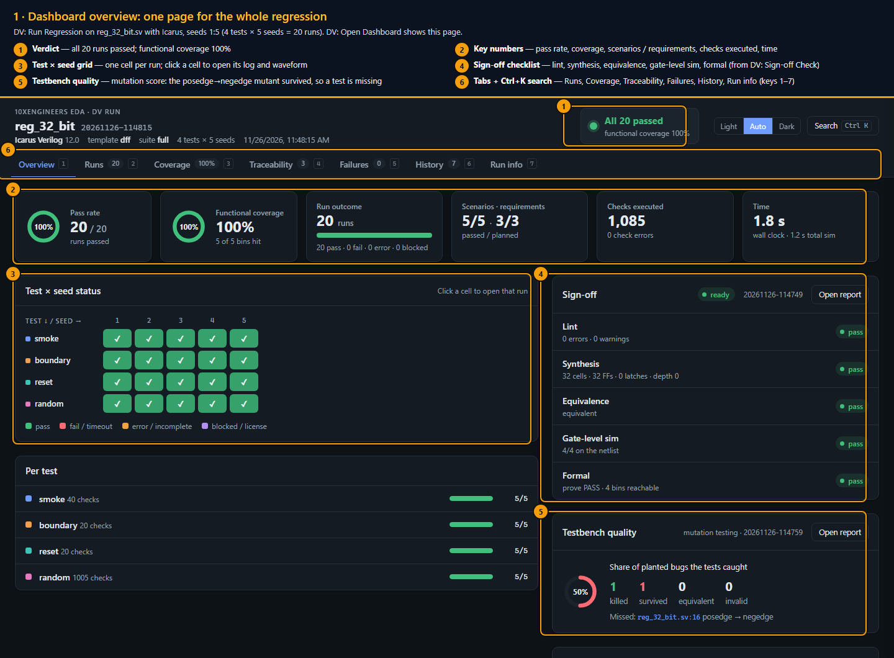
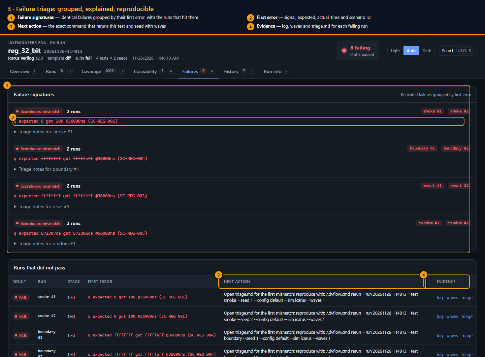
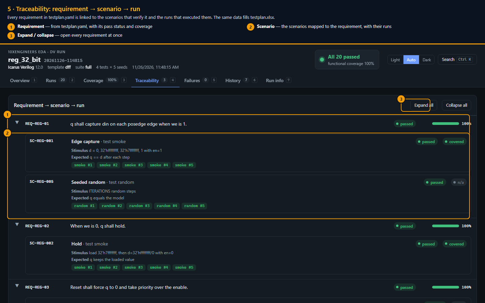
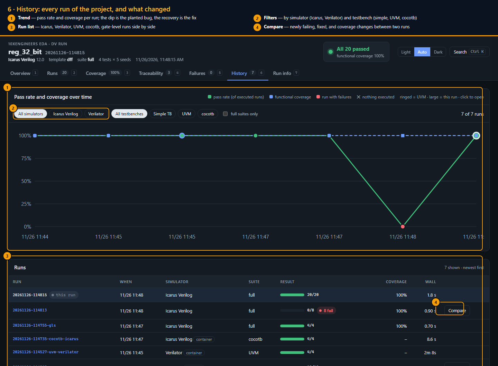

# The dashboard

| Tab | What you get |
|---|---|
| **Overview** | Verdict, pass rate, coverage, a test × seed grid and testbench quality. Click a cell to open that run. |
| **Runs** | Search, filter and sort. Click a run to see its log, waveform, scenarios and bins, and **Rerun with waves**. |
| **Coverage** | Bins, which test hit which bin, and the uncovered DUT lines. |
| **Traceability** | Requirement → scenario → run, including requirements that no test covers. |
| **Failures** | Grouped failure signatures with triage notes. |
| **History** | Trends across runs, and **Compare** to see what broke or got fixed. |

Times in the log, such as `t=125 ns`, jump the waveform cursor. Press **Ctrl+K** to search everything.

## In pictures

The numbered labels on each picture are explained in its top bar.

**Overview**

**Failures: grouped by first error, each with the command that reproduces it**

**Traceability: requirement → scenario → run**

**History: trends across runs, and Compare**

