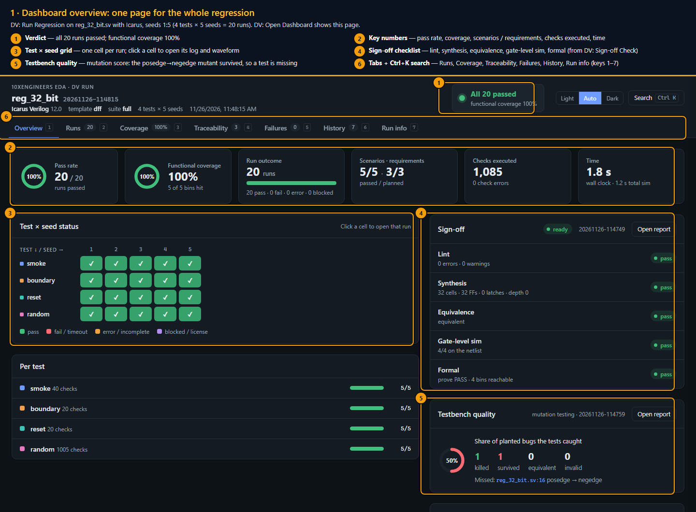

# The demo

**Create Demo Project** asks for a folder, puts a small design in it (a 4-bit ripple-carry adder) and generates everything from that one file: `dvflow.json`, an SV testbench, a UVM environment, a cocotb testbench and a test plan. The **Demo Tour** then opens. It has one button per step, and each step explains what it does and why it matters:

1. Check the toolchain
2. See what one RTL file turned into
3. Run a regression
4. Explore the dashboard
5. Measure code coverage (Verilator)
6. Run the UVM testbench (no license)
7. Run the cocotb testbench
8. Plant a bug and watch it get caught
9. Formal proof, with a counterexample for the bug
10. Fix it and confirm, in History → Compare
11. Measure testbench quality (mutation testing)
12. Sign-off check

The whole tour takes about 5 minutes. When you're done, use **DV: Select DUT** on your own design.

## In pictures

The numbered labels on each picture are explained in its top bar.

**What the demo ends with: every run, coverage, sign-off and testbench quality on one page**

