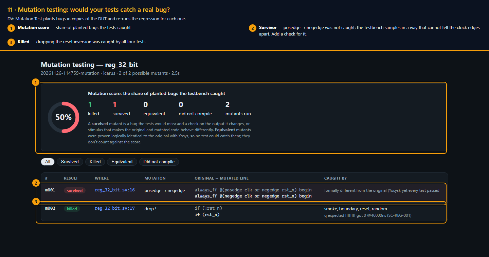

# Is the testbench any good?

A green regression only shows that the tests passed. **Mutation testing** checks whether they would *fail* when the design is wrong:

1. Small, realistic bugs are planted in copies of the DUT, for example `&`→`|`, `+`→`-`, `==`→`!=`, `posedge`→`negedge`, or a flipped constant.
2. The regression runs against each copy (*mutant*).
3. Each mutant is classified:

| Result | Meaning |
|---|---|
| **killed** | A test failed. The bug was caught. |
| **survived** | Every test still passed. This is a hole in the testbench. |
| **equivalent** | Yosys proved the mutant logically identical to the original, so no test could catch it. Not counted. |
| **invalid** | The mutant didn't compile. Not counted. |

**Mutation score** = killed / (killed + survived). For each survivor, the report links to its line: add a check or stimulus that makes the original and the mutant behave differently.

## In pictures

The numbered labels on each picture are explained in its top bar.

**Mutation report: one survivor shows a missing check**

