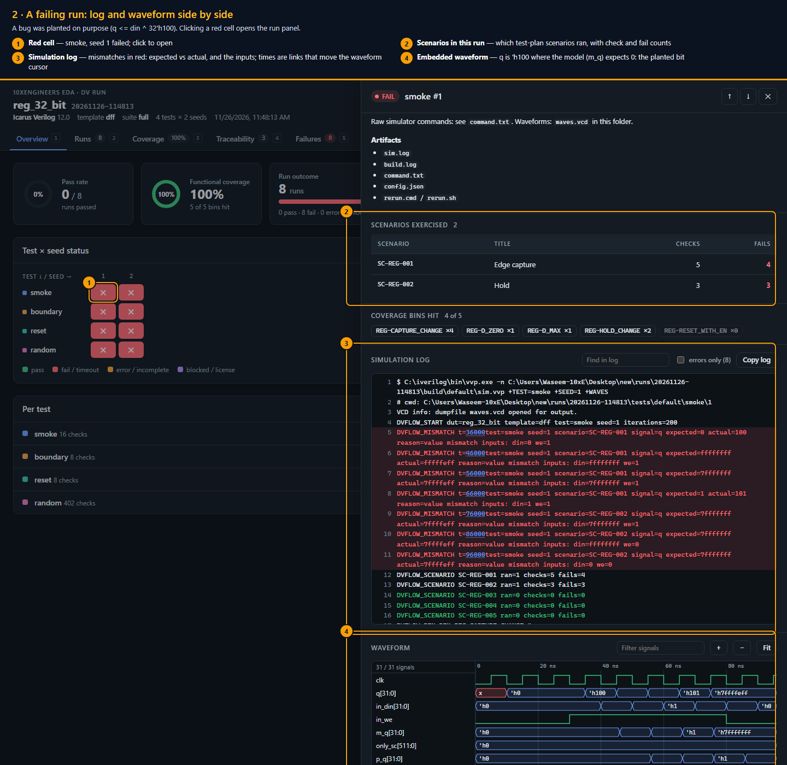
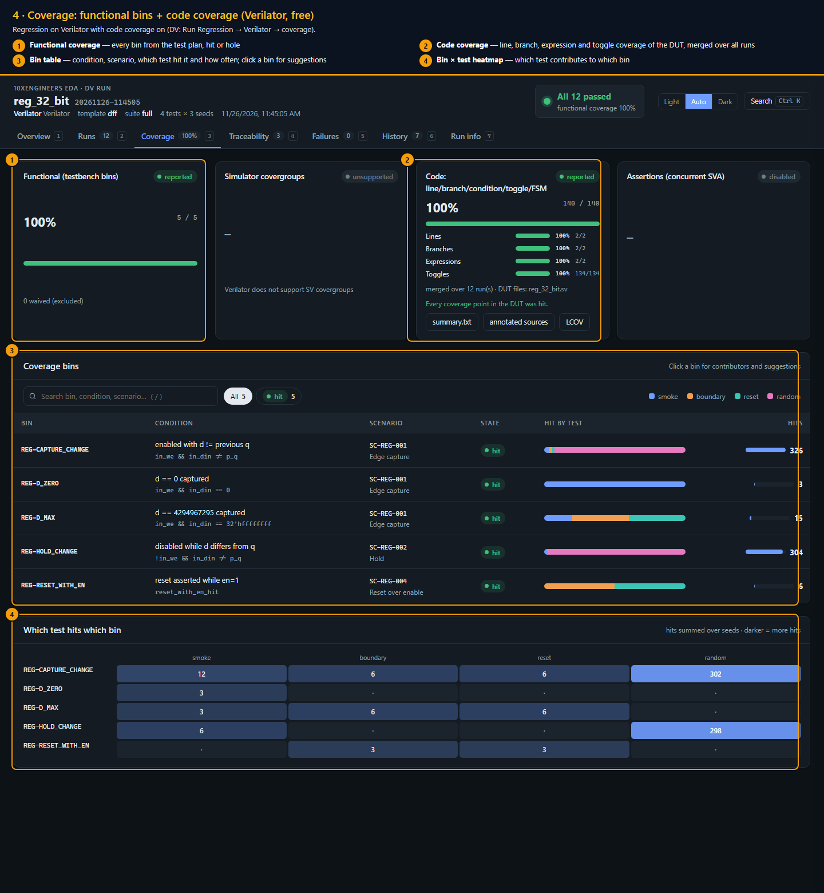
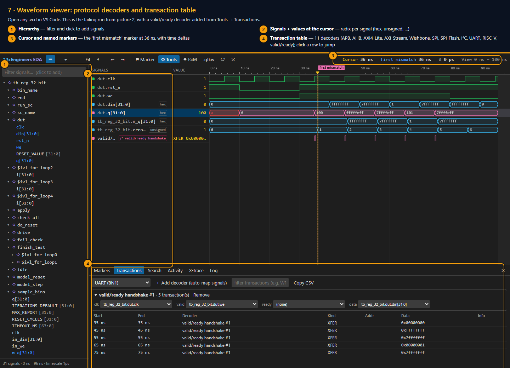
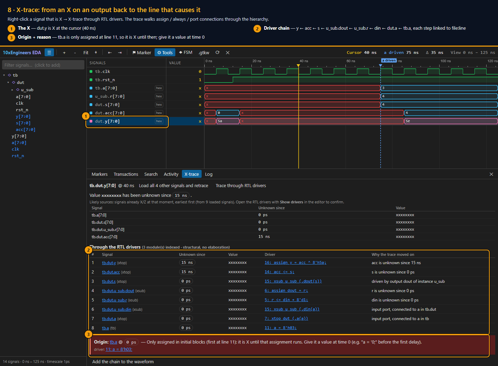

# Run tests and regressions

- **DV: Run Test:** pick the testbench (simple or UVM), the simulator, a test, a seed and the number of runs.
- **DV: Run Regression:** a whole suite across several seeds.

| Simulator | Simple TB | UVM | Code coverage |
|---|---|---|---|
| Icarus | ✓ | | |
| Verilator | ✓ | ✓ | ✓ line, branch, toggle |
| Questa | ✓ | ✓ | ✓ including covergroups |
| VCS | ✓ | ✓ | ✓ |

Turn on **code coverage** to get a list of DUT lines and conditions that no test exercised. Every run also updates `testplan.yaml` and `testplan.xlsx` with its results.

## In pictures

The numbered labels on each picture are explained in its top bar.

**A failing run: log and waveform side by side**

**Coverage after a Verilator run with code coverage on**

**Waveform viewer with a protocol decoder and transaction table**

**X-trace: from an X on an output back to the line that causes it**

